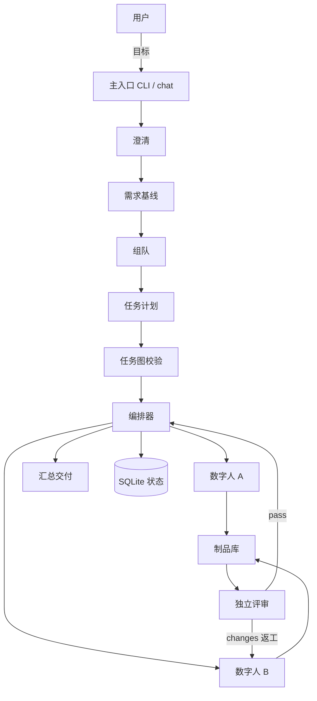

# AI Team

主入口对话驱动的数字人团队：**你只说目标，系统负责组队、拆活、执行、评审、汇总。**

不用再在一个对话框里同时扮演产品、架构、开发、测试和评审——把目标说清楚，剩下的交给一支有角色人设的数字人团队。

```
目标 > 为质量团队做一个周报自动汇总工具：拉取任务与缺陷数据，生成周报并支持导出

团队：质量团队项目组（5 人）
  · 林知远（产品负责人） [lead] — 把模糊的目标变成可以被验收的交付基线
  · 周砚舟（架构师） — 在约束内给出可落地的结构、接口与取舍
  · 陈墨白（后端工程师） — 把接口契约落成可运行的服务与数据模型
  · 沈砚秋（测试工程师） — 用可执行的用例证明交付达标
  · 秦非（评审专家） — 独立判断产出是否达标

任务计划：
  t1 需求边界与验收标准 ← 起点
  t2 技术方案与接口契约 ← t1
  t3 接口与数据模型设计 ← t2
  t4 测试计划与用例设计 ← t3

==> 汇总完成：final_report.md（4 个任务，未闭环 0 个）
```

## 为什么要做成「团队」

单人问 AI 的四个老问题，本质都不是模型不够强，而是**流程缺失**：

| 问题 | 团队化怎么解 |
| --- | --- |
| 目标没说清就开工 | 主入口先澄清，产出可验收的需求基线，后续所有角色都以它为判断依据 |
| 自己写自己评，问题发现不了 | 独立评审角色逐条对照验收标准，不通过就带着具体意见返工 |
| 一本流水账，角色约束互相污染 | 每个数字人有独立人设、职责边界与过程记忆，只拿自己该看的上下文 |
| 做完只剩聊天记录 | 基线、团队、任务、评审、产物全部落盘，可查可导出 |

## 核心概念

- **主入口**：唯一对话入口。接目标 → 提澄清问题 → 组建团队 → 触发执行 → 交付结果。
- **数字人**：角色模板（使命/能力/边界/表达风格）+ 独立上下文 + 过程记忆。
- **数字人团队**：本次目标的最小角色集合，含一名 lead 统筹，必有产品与评审。
- **任务图**：有向无环依赖图，一任务一负责人，产物进制品库。
- **评审闭环**：产出必须过独立评审，`changes` 带着具体 issues 返工，轮次有上限。

## 快速开始

零第三方依赖，只要 Python 3.9+。

```bash
git clone https://github.com/<you>/ai-team.git
cd ai-team

# 1. 用示例目标跑一次完整流程（离线规则实现，不需要密钥）
python3 -m ai_team demo

# 2. 主入口对话模式：输入目标 → 澄清 → 确认 → 执行
python3 -m ai_team chat

# 3. 一次性执行（CI/脚本友好）
python3 -m ai_team run "为质量团队做一个周报自动汇总工具" --report

# 4. 查看与导出
python3 -m ai_team status
python3 -m ai_team export latest --out dist
```

安装成命令（可选）：

```bash
pip install -e .
ai-team demo
```

## 一次运行产出什么

```
.ai_team/runs/20261116-112342-为质量团队做一个周报自动汇总工具-03f2/
├── brief.md            # 需求基线：目标、交付物、约束、验收标准
├── team.md             # 数字人卡片：谁负责什么、边界在哪
├── plan.md             # 任务计划与依赖
├── final_report.md     # 交付说明：结论、团队、产物、验收对照
├── artifacts/          # 每个角色的完整产物
│   ├── t1-需求边界与验收标准.md
│   ├── t2-技术方案与接口契约.md
│   └── ...
├── state.db            # SQLite：任务状态、消息、事件
├── run.json            # 运行快照（可移植）
└── run.log             # 事件日志
```

`ai-team export` 会把汇总与全部产物合成**一份** Markdown，方便直接分发。

## 命令

| 命令 | 作用 |
| --- | --- |
| `ai-team chat` | 主入口对话模式，可连续处理多个目标 |
| `ai-team run "目标"` | 一次性执行；`--interactive` 先做澄清问答，`--report` 打印交付说明摘要 |
| `ai-team demo` | 用内置示例目标离线跑通全流程 |
| `ai-team status [run_id]` | 查看最近/指定运行的任务状态与产物 |
| `ai-team export [run_id] --out dist` | 导出单文件交付包 |
| `ai-team roles` | 查看 8 个角色模板的职责与产出章节 |
| `ai-team init` | 初始化数据目录 |

## 接入真实模型

默认 `provider=mock`（规则实现，离线可跑、结果稳定，用于演示与回归）。接真实模型只需环境变量：

```bash
export AITEAM_PROVIDER=ark              # ark | openai | mock
export AITEAM_API_KEY=...               # ark 也可用 ARK_API_KEY
export AITEAM_MODEL=doubao-seed-1-6-250615
export AITEAM_BASE_URL=https://ark.cn-beijing.volces.com/api/v3   # 可选，默认已填
```

任何 OpenAI 兼容网关同理，改 `AITEAM_BASE_URL` 与模型名即可。其他可调项：

| 环境变量 | 默认 | 说明 |
| --- | --- | --- |
| `AITEAM_DATA_DIR` | `.ai_team` | 运行数据目录 |
| `AITEAM_MAX_REWORK` | `1` | 评审返工轮数上限 |
| `AITEAM_TIMEOUT` | `120` | 单次模型调用超时（秒） |

**模型不可用不会让整轮运行崩掉**：结构化阶段（基线/组队/计划）失败自动回落到规则实现，单任务生成失败单任务回落，均写入事件日志。

## 架构



分层：入口层（`cli`）/ 编排层（`orchestrator`）/ 协作层（`tasks`,`store`,`workspace`）/ 角色层（`personas`,`models`）/ 推理层（`reasoner`,`offline_reasoner`,`factory`）。

设计取舍见 [docs/tech-design.md](docs/tech-design.md)，需求与验收见 [docs/PRD.md](docs/PRD.md)。

## 关键实现细节

- **JSON 优先 + 一次修复重试**：结构化阶段只允许输出 JSON，解析失败追加纠错提示重试；业务校验（角色合法、任务无环）失败同样重试。
- **回落优先于失败**：主推理失败即切规则实现，事件里留痕，保证「一次运行必须给出交付包」。
- **上下文裁剪**：上游产物按 1600 字符/份、6400 字符总量截断，避免长上下文淹没任务指令。
- **失败传播**：单任务重试一次后仍失败则 `failed`，下游递归 `blocked`，其余分支继续跑。
- **状态双写**：`run.json` 快照 + SQLite 查询库，互为补充而非互相依赖。

## 目录结构

```
ai-team/
├── ai_team/                 # 核心包（仅标准库）
│   ├── cli.py               # 主入口与命令
│   ├── orchestrator.py      # 五阶段流程、评审闭环
│   ├── reasoner.py          # 真实模型推理
│   ├── offline_reasoner.py  # 规则实现（mock/回落）
│   ├── prompts.py           # 分阶段提示词
│   ├── personas.py          # 8 个角色模板
│   ├── tasks.py             # 任务图校验与调度
│   ├── store.py             # SQLite 状态库
│   ├── workspace.py         # 运行目录与产物
│   └── export.py            # 单文件导出
├── tests/                   # 43 项 unittest，无网络依赖
├── docs/                    # PRD 与技术方案
├── examples/goals.md        # 可直接试跑的目标
└── scripts/push_github.sh   # 建仓并推送
```

## 测试

```bash
PYTHONPATH=. python3 -m unittest discover -s tests -v
# 43 tests, OK
```

覆盖：JSON 抽取边界、任务图环检测/就绪集/阻塞传播、模型序列化、离线设计（基线吸收澄清、并行分支）、端到端运行（产物、评审返工、持久化、导出、失败传播）、CLI 返回码与参数位置。

## 路线图

- v0.2：`resume` 断点续跑、就绪任务并行执行
- v0.3：工具执行器（白名单）、长期记忆检索
- v0.4：Web 入口（SSE 进度）、多团队竞标择优

## 许可

MIT
