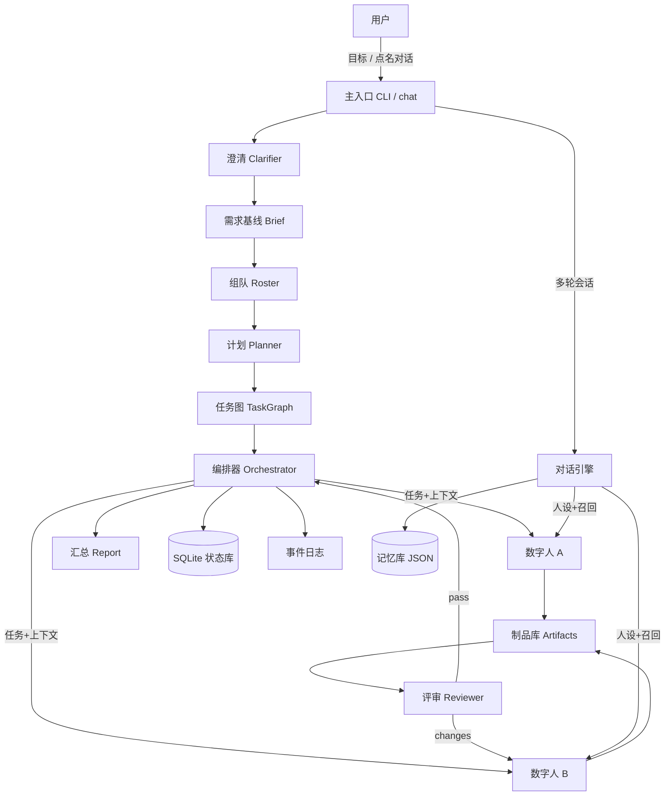
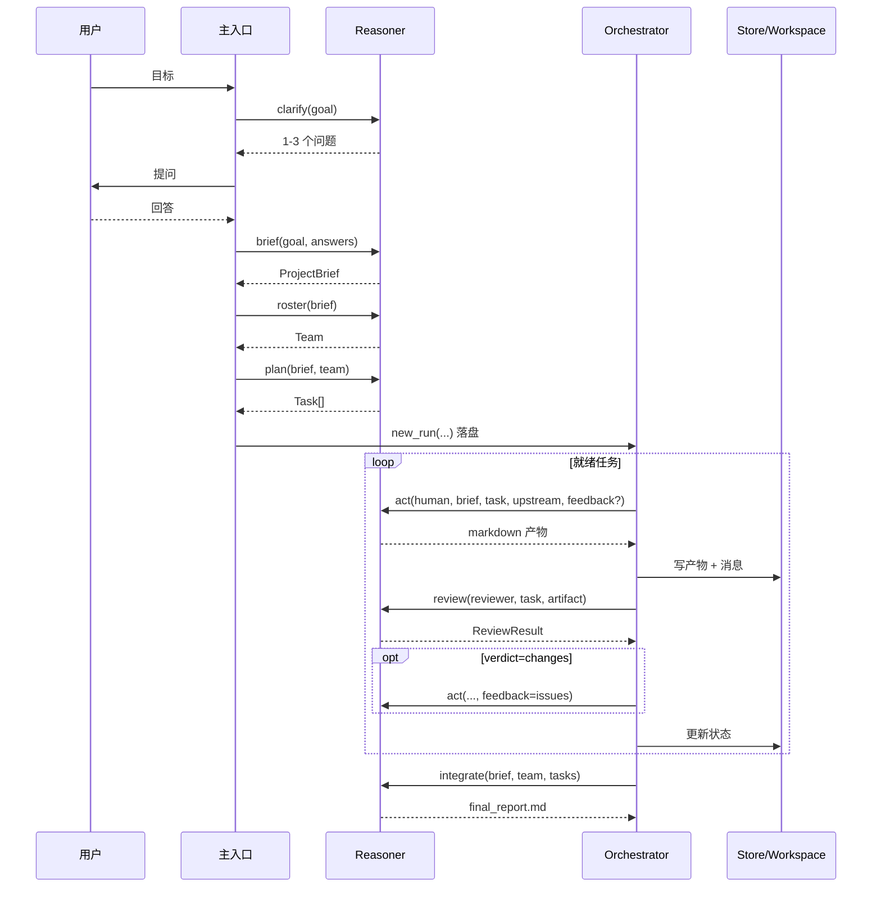

# AI Team 技术方案

> 版本：v0.2　对应 PRD：v0.2　最后更新：2026-11-16

## 变更记录

| 版本 | 变更 |
| --- | --- |
| v0.1 | 五阶段编排、任务图、评审闭环、状态双写 |
| v0.2 | 增加数字人对话引擎、跨运行记忆库、形象资源与名片渲染 |

## 1. 总体架构



分层：

| 层 | 模块 | 职责 |
| --- | --- | --- |
| 入口层 | `cli` | 解析命令、交互澄清、点名对话、展示进度、导出 |
| 编排层 | `orchestrator` | 阶段推进、任务调度、评审闭环、失败处理 |
| 对话层 | `conversation` | 人设提示重建、多轮上下文、记忆召回与写入 |
| 协作层 | `tasks` / `store` / `workspace` | 任务图校验、状态持久化、产物与形象资源落盘 |
| 角色层 | `personas` / `models` / `assets` | 角色模板、数字人实例、团队、形象映射 |
| 推理层 | `reasoner` / `offline_reasoner` / `factory` | 基线、组队、计划、执行、评审、汇总、对话 |
| 记忆层 | `memory` | 每人一个记忆文件：事实、偏好、最近会话 |

## 2. 模块清单

| 文件 | 关键接口 | 说明 |
| --- | --- | --- |
| `ai_team/config.py` | `load_settings()` | 三级配置：命令行 > 环境变量 > 默认值 |
| `ai_team/jsonutil.py` | `extract_json()` | 从模型输出中抽取 JSON，容忍代码块与前后说明 |
| `ai_team/models.py` | `ProjectBrief` `DigitalHuman` `Team` `Task` `Message` `ReviewResult` `Run` | 纯数据结构，支持 dict 互转 |
| `ai_team/personas.py` | `ROLES` `create_human()` `catalog_text()` | 8 个角色模板 + 姓名池 |
| `ai_team/tasks.py` | `TaskGraph` | 校验、拓扑排序、就绪队列、进度 |
| `ai_team/llm.py` | `ChatClient.complete()` | OpenAI 兼容 `/chat/completions`，仅标准库 |
| `ai_team/memory.py` | `MemoryStore` | 按人持久化记忆、召回打分、清空 |
| `ai_team/conversation.py` | `DigitalHumanChat` | 多轮对话：人设重建 + 记忆召回 + 落库 |
| `ai_team/assets/avatars/` | 8 张角色形象 | 扁平插画头像，随运行目录复制 |
| `ai_team/prompts.py` | 各阶段提示词 | 统一「只输出 JSON」约束与 schema |
| `ai_team/reasoner.py` | `Reasoner` `LLMReasoner` | 真实模型实现，含一次 JSON 修复重试 |
| `ai_team/offline_reasoner.py` | `OfflineReasoner` | 规则版：关键词选角、模板计划、结构化正文、规则评审 |
| `ai_team/factory.py` | `build_reasoner()` | 按 provider 选择实现 |
| `ai_team/store.py` | `RunStore` | SQLite 持久化 |
| `ai_team/workspace.py` | `RunWorkspace` | 运行目录、产物路径、运行索引 |
| `ai_team/orchestrator.py` | `Orchestrator.new_run()` / `.execute()` | 五阶段主流程 + 回落策略 |
| `ai_team/cli.py` | `main()` | `init/run/chat/status/export/roles/demo` |

## 3. 数据模型

### 3.1 内存模型

```python
ProjectBrief(goal, background, deliverables[], constraints[], acceptance[], open_questions[])
DigitalHuman(id, name, role, title, mission, skills[], responsibilities[], boundaries[], voice, memory[])
Team(name, lead, members[DigitalHuman])
Task(id, title, role, description, deliverable, depends_on[], assignee, status, artifact, rounds, review{})
ReviewResult(verdict, issues[], summary)
Run(id, goal, dir, brief, team, tasks[], status)
```

任务状态机：

```
pending → running → (done | failed)
                ↑        │
                └ review ┘   verdict=changes 且 rounds < max_rework → 回到 running
downstream: pending → blocked（上游 failed 或 blocked）
```

### 3.2 SQLite（`state.db`）

| 表 | 字段 | 用途 |
| --- | --- | --- |
| `runs` | id, goal, status, dir, created_at, updated_at | 运行索引 |
| `members` | run_id, id, name, role, title, mission | 团队名单查询 |
| `tasks` | run_id, id, title, role, assignee, status, depends_on(json), artifact, rounds, review(json) | 任务状态 |
| `messages` | seq, run_id, ts, sender, recipient, kind, body | 交接与评审对话 |
| `events` | seq, run_id, ts, kind, detail | 阶段事件、告警 |
| `artifacts` | run_id, task_id, author, path, title | 产物索引 |

以 `run.json` 为「人读 + 可移植」快照，SQLite 仅用于查询，二者不互为依据，避免单点损坏导致不可恢复。

## 4. 关键流程



## 5. 提示词与结构化输出策略

1. **单职责提示词**：每个阶段只做一件事（澄清/基线/组队/计划/执行/评审/汇总），避免长指令互相干扰。
2. **JSON 优先**：结构化阶段只输出 JSON，schema 写在系统提示里；解析失败自动追加「上一次输出无法解析」重试一次。
3. **两段校验**：解析后做业务校验（角色 key 合法、任务无环、依赖存在），失败同样重试一次。
4. **规则回落**：真实模型任一环节失败（网络、限流、格式），自动改用 `OfflineReasoner` 的对应能力并写入 `events(kind=warn)`，保证运行不中断。
5. **上下文裁剪**：上游产物按任务截断（默认每份 1600 字符，总量 6400），避免长上下文淹没任务指令。

## 5.1 数字人对话与记忆（v0.2）

**目标**：让每个角色像真人同事一样可被点名对话，且跨会话记住事实。

对话链路：

```
用户输入 → 解析 @姓名/角色 → 载入 DigitalHuman + 记忆召回 Top-K
        → 重建人设 system（每轮重建，避免历史稀释）
        → 携带最近 N 轮对话（默认 8）
        → 模型回复（失败回落规则对话）
        → 落库：history + 可选记忆条目
```

关键约束：

1. **每轮重建人设**：不复用上一轮的完整提示，避免轮次变多后人设漂移。
2. **记忆分级**：`fact`（用户陈述的事实，如「周报按周一到周五统计」）、`preference`（偏好，如「结论先给」）、`note`（过程记录）。任务级一次性要求不写入长期记忆。
3. **召回打分**：`score = 词面重合度 × 0.7 + 角色相关度 × 0.3 + 时间衰减`，取 Top 3，单条截断 200 字。
4. **可见性**：写入记忆时 CLI 打印「已记住：…」；`ai-team memory` 可列出，`--forget` 可清空。
5. **越权转交**：问到不属于本角色职责的问题时，回复中明确「这块由 X 负责」，不硬答。

记忆文件（`.ai_team/memory/<human_id>.json`）：

```json
{
  "human_id": "qa_engineer",
  "name": "沈砚秋",
  "notes": [{"ts": "2026-11-16 12:20", "kind": "fact", "text": "周报按周一到周五统计"}],
  "history": [{"ts": "2026-11-16 12:21", "role": "user", "text": "..."},
              {"ts": "2026-11-16 12:21", "role": "human", "text": "..."}]
}
```

容量控制：`notes` 上限 50 条，`history` 上限 50 轮，超出按时间淘汰最旧。

形象资源：`assets/avatars/<role>.jpg`（512px，约 40KB）。运行时复制到 `runs/<run_id>/assets/avatars/`，`team.md` 用相对路径引用，保证运行目录自包含、可离线渲染；图片缺失时降级为纯文字名片，不抛错。

## 6. 评审闭环设计

- 评审器输入：任务定义 + 交付物要求 + 产物全文 + 基线验收标准。
- 输出：`verdict`（pass/changes）、`issues`（可执行的具体修改点）、`summary`。
- `changes` 时把 issues 原样回灌给产出数字人，提示词中标注「本轮为第 N 次返工，必须逐条回应」。
- 轮次上限 `max_rework`（默认 1）：到上限仍 changes 时，任务标记 `done` 但在 `review` 中保留未通过结论，由汇总阶段显式列出未闭环项。

## 7. 配置与真实模型接入

```bash
export AITEAM_PROVIDER=ark
export AITEAM_API_KEY=...                      # 或 ARK_API_KEY
export AITEAM_MODEL=doubao-seed-1-6-250615     # 按账号可用模型填写
export AITEAM_BASE_URL=https://ark.cn-beijing.volces.com/api/v3   # 可选
```

`openai` 兼容网关同理，只需改 `AITEAM_BASE_URL` 与模型名。请求走 `/v1/chat/completions`，`urllib` 直连，超时与重试在 `ChatClient` 内收敛。

### 7.3 两种 wire_api

部分网关（如内网 Model Hub）只暴露 OpenAI 的 Responses 协议，用 `AITEAM_WIRE_API` 切换：

| 取值 | 请求 | 请求体 | 响应解析 |
| --- | --- | --- | --- |
| `chat`（默认） | `POST {base_url}/chat/completions` | `messages[]` + `max_tokens` | `choices[0].message.content` |
| `responses` | `POST {base_url}/responses` | `input[]` + `max_output_tokens` | `output_text` 或 `output[].content[].output_text` |

`hub` provider 预置 `base_url=https://dataagent-dev-llm.bytedance.net/v1`、`model=gpt-5.6-terra`、`wire_api=responses`，密钥读 `AITEAM_API_KEY` / `MODEL_HUB_API_KEY` / `OPENAPI_SK`。解析逻辑对两种结构都做了兜底：只要响应里存在 `output_text`、`output[]` 的文本块、或 `choices[]`，都能取到正文；三者皆空才抛 `LLMError`。

## 8. 错误处理与可观测

| 场景 | 行为 |
| --- | --- |
| 模型调用失败 | 单任务重试 1 次；仍失败 → `failed`，记事件，下游 `blocked` |
| JSON 不可解析 | 追加纠错提示重试 1 次；仍失败 → 回落规则实现 |
| 团队结构非法 | 回落规则组队，保留告警事件 |
| 任务图非法 | 回落规则计划 |
| 进程中断 | `run.json` 为快照，可据此续跑（v0.2 提供 `resume`） |

可观测：`run.log` 逐行事件；`state.db.events` 可查询；CLI 每阶段打印 `[i/n]` 进度与任务结论。

## 9. 安全与权限

- 运行数据全部落本地目录，不外发。
- 提示词中不拼接密钥；密钥只从环境变量读取，日志中不打印。
- 数字人不执行真实系统命令，产物为文本制品；接入工具执行器需在 v0.2 通过白名单单独设计。

## 10. 扩展点

| 方向 | 落点 |
| --- | --- |
| 语音输出 | `conversation` 增加 TTS 适配层，`DigitalHuman.voice_id` 已是字段 |
| 并行执行 | `orchestrator` 就绪任务按依赖层分组，线程池并发，`store` 需加锁 |
| 工具调用 | `personas.RoleTemplate.tools` 已是字段，新增 `tools/` 执行器注册表 |
| 长期记忆 | 记忆库换成向量检索，召回接口不变（Top-K + 截断） |
| Web 入口 | `conversation` 与 `cli` 解耦，可挂 FastAPI 暴露 SSE 对话与进度 |
| 多团队/竞标 | 同基线生成两套团队，按评审得分择优 |

## 11. 目录结构

```
ai-team/
├── ai_team/            # 核心包（零第三方依赖）
├── assets/avatars/     # 8 个角色的形象资源
├── tests/              # unittest，覆盖图校验、离线全流程、对话与记忆、CLI
├── docs/               # PRD、技术方案
├── examples/           # 示例目标
├── scripts/            # 推送/演示脚本
├── pyproject.toml
└── README.md
```

## 12. 测试策略

- **单元**：`extract_json` 边界（代码块、前后解释、截断）、`TaskGraph` 环检测/就绪集、角色模板完整性、记忆召回打分与容量淘汰。
- **集成**：`mock` 提供方端到端跑一次，断言产物数量、最终报告包含目标与验收项、评审轮次受限；对话多轮不漂移、跨运行记忆可复述。
- **CLI**：`run`/`status`/`export`/`talk`/`memory` 返回码与关键输出。
- 全部测试无网络依赖，可直接进 CI。
